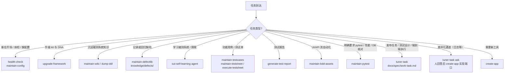

<!-- version: 2.0.0 -->
# AGENTS — TestPilot 总入口

> TestPilot 用一个 Git 仓库加一套 rule / skill / agent / hook，约束读这个仓库的 AI 怎么工作，
> 同时让测试工程师把工作信息都存进同一个仓库维护。本文件只写不常变的结构与原则。
>
> - 业务资产地图：[`INDEX.project.md`](INDEX.project.md)（生成任何测试、资产、工具前先读）。
> - AI 组件与版本：[`.cursor/REGISTRY.md`](.cursor/REGISTRY.md)（`tuner-index-ai` 确定性生成）。
> - 本仓补充约定：存在 `AGENTS.local.md` 时一并读，它优先于本文件的通用默认。`tuner-dna sync` 永不改它。
> - 运行库与 CLI 来自 PyPI 包 `tuner-testkit`（导入名 `tuner_testkit`，命令 `tuner-*`）。

<!-- platform-only:begin -->
> **平台仓说明**：你正在平台仓里（`tuner_testkit/` 源码 + DNA 源）。平台能力地图是 [`INDEX.md`](INDEX.md)；
> `dogfood/` 是同一 scaffold 生成的 workspace 示范，它的业务地图是 `dogfood/INDEX.project.md`。
> 平台与下游仓的分工见文末「平台仓与下游仓」。
<!-- platform-only:end -->

## 1. 分层结构

| 层 | 目录 | 职责 | 演进节奏 |
| --- | --- | --- | --- |
| 知识层 | `knowledge/` | 被测系统的知识：`ddl/`（自动区）、`raw/`（原件只读）、`wiki/`（LLM 维护的业务讲解、用例场景、探索、design）、`requirements/`、`defects/`。见 `docs/spec/knowledge-syntax.md`。 | 随被测系统和业务演进 |
| 资产层 | `assets/` + `packages/` | 测试资产活文档。`assets/` 放 Markdown（`testdesign/`、`testcases/`、`testsheet/`、`testreport/`、`sql/`），`packages/` 放 Python（`api_objects/`、`page_objects/`、`action_words/`）。见 `docs/spec/assets-knowledge-syntax.md`。 | 随测试工作演进 |
| 工具层 | `apps/` | 本仓私有 CLI 工具，含端口适配器（见 §4）。公共工具在 kit 的 `tuner-*`。见 `docs/spec/apps-authoring-syntax.md`。 | 按需 |
| 数据层 | `data/` | 测试数据、账号（含角色与权限）、mock。见 `docs/spec/data-syntax.md`。 | 按需 |
| 测试层 | `tests/` | behave `features/` 与 `pytest/`。 | 按需 |
| 配置 | `config/` | 「在哪、用什么」：环境、运维通道、端口绑定、执行通道、知识位置。见 §5。 | 按环境 |
| 文档层 | `docs/` | 规范 `docs/spec/**`、升级说明 `docs/changelog/TEMPLATE-*.md`。 | 随 kit |

配套：`work/tasks/`（入库的任务，`docs/spec/work-task.md`）；`artifacts/`（本机产出，gitignore：`evidence/`、`inbox/`、`runs/`、`reports/`、`catalogs/`，见 `docs/spec/artifacts-layout.md`）。

## 2. 三角色

- **测试工程师**：提出任务和判断；把高置信度经验沉淀进 `knowledge/` 与 `assets/`；回答阻塞提问（`tuner-task answer`）。
- **LLM（TestPilot）**：读 `INDEX.project.md`、`knowledge/`、`assets/` 作为生成依据，不凭空编造；按 skill 维护资产并留痕。
- **通道**：浏览器（`CHANNELS.browser` 选 Playwright MCP 或 Cursor 浏览器）、API（`tuner_testkit.api_test`）、数据库（`tuner_testkit.db`）、端口适配器（如后端日志，见 §4）。

## 3. AI 组件

`.cursor/**` 下的 rule / skill / agent / hook 相当于测试平台后端的业务规则与处理逻辑，版本化、人可读。

- **口诀**：能确定性脚本化就用 hook / app，别用 LLM；是约束就用 rule；是流程就用 skill；要串流程就用 agent。
- **对外 skill 按三组**（front-matter `group`；其余为 `internal`，由入口 skill 或 agent 调用）：
  - 知识：`maintain-wiki`、`dump-ddl`、`maintain-defectlib`
  - 动作：`maintain-testcases`、`maintain-testsheet`、`execute-testsheet`、`generate-test-report`、`maintain-bdd-assets`、`maintain-pytest`
  - 可用性：`health-check`、`upgrade-framework`、`maintain-config`、`create-app`

## 4. 扩展原则：端口与自定义 apps

各团队差异大的能力，kit 只定义**端口**（契约），不提供实现。典型是后端日志：有的团队 SSH 进目录，有的走日志平台 API，有的走 Rancher。

- **kit 实现**：通用且稳定的通道（db、api、page、fake、evidence）。
- **workspace 实现**：端口适配器。按 `docs/spec/apps-authoring-syntax.md` 在 `apps/<name>/` 写 CLI app，`@tool(port="<端口>")` 声明它实现哪个端口，在 `config` 的 `PORTS` 里绑定。契约见 `docs/spec/ports.md`（首个端口 `log-source`）。
- **流程**：仓库没写明通道时先 `tuner-task ask`（日志主题 `sut-log-source`），**人回答前不选通道、不写实现**。回答后用 `create-app` 按端口契约生成适配器，用 `maintain-config` 写 `PORTS` 与 `OPS`，`health-check` 复检。
- 同样的思路适用于 Rancher 操作等团队特有的通道：先找 `ports.md` 有没有契约，没有就当普通私有 app。
- 不是端口的：内容与位置能统一的记录（用例、需求、缺陷）。它们有固定目录、模板与 skill，例如缺陷库 `knowledge/defects/`（`docs/spec/defect-syntax.md`，skill `maintain-defectlib`）。

## 5. 配置原则

`config/` 只回答「在哪、用什么」，是这些信息的唯一来源；`knowledge/wiki` 只解释为什么，引用配置键名，不重复写值。

- 提交的 `config/env.py`（占位与非密钥）被 gitignore 的 `config/env_local.py` 覆盖；多套环境写在 `ENVIRONMENTS`，`tuner-config use <name>` 切换。
- 分类：被测系统环境（`TEST_UI_BASE_URL`、`TEST_BASE_URL`、`DATABASES`、`TEST_ACCOUNT`）、运维通道 `OPS`、端口绑定 `PORTS`、执行通道 `CHANNELS`、知识位置 `KNOWLEDGE`。字段见 `docs/spec/config-syntax.md`。
- LLM 判断当前环境与通道只用 `tuner-config show --json`（密钥打码）；改配置走 `maintain-config` skill，改完跑 `tuner-config validate`。

## 6. 任务分诊

拿到任务先判断类型，再选路。没有默认强制的工作流，BDD 只是能力之一。

- **开场 / 体检**：`health-check` 先跑 `tuner-workspace doctor --json`，缺配置交给 `maintain-config`，只能人定的（日志通道等）走 `tuner-task ask`。
- **发布任务**：`tuner-task create` 写入 `work/tasks/`。测试设计走 `derive-test-design`，端到端点击报告走 `run-test-execution`。
- **功能用例**：`maintain-testcases`，落在 `assets/testcases/<模块>/<套件>/<用例ID>.md`，`source` 优先指向 `knowledge/requirements/` 的需求 ID。
- **测试单**：`maintain-testsheet` 组单，`execute-testsheet` 逐条执行并回写，缺陷用 `maintain-defectlib` 沉淀到 `knowledge/defects/`，报告用 `generate-test-report`。
- **明确 pytest**：直接写 pytest，不为满足分层硬造 Gherkin。

## 7. 追溯：对象级 changelog

`artifacts/inbox/` 是本机会话流水，不入库。追溯靠被维护对象自己的记录，随提交入库：

- 单元文件（用例、需求、缺陷、wiki 页等）改动时 bump front-matter 的 `version`。
- 库根目录 `CHANGELOG.md`（wiki 用 `knowledge/wiki/log.md`）每次维护追加一行：`tuner-workspace changelog append`。
- `tuner-workspace changelog check --staged` 在 pre-commit 校验：动了维护区就要有 changelog 行，改了单元就要 bump 版本。规范见 `docs/spec/metadata-conventions.md` §4。

## 8. 全程硬约束

- 不得把 token / cookie / Authorization / 密码 / session 写入仓库（含 capture、api_objects、任务、提问、changelog）。
- 密钥只放 `config/env_local.py`、`data/**/*.local.yaml` 或环境变量。
- 提交遵循 Conventional Commits 加分层 scope，见 `docs/spec/commit-convention.md`（`commit-msg` hook 校验）。
- DB 只走 `tuner_testkit.db`，日志只走 `tuner_testkit.logging`，假数据只走 `tuner_testkit.fake`。
- 不在 `.cursor/`、`docs/spec/`、`AGENTS.md` 里写本仓定制：写进 `*.local.mdc`、`AGENTS.local.md`，否则 `tuner-dna sync --overwrite` 会覆盖。

<!-- platform-only:begin -->
## 9. 平台仓与下游仓

本仓维护平台：`tuner_testkit/`（PyPI `tuner-testkit`）、DNA（`.cursor/**`、`docs/spec/**`、`docs/changelog/TEMPLATE-*.md`、`tools/git-hooks/`、`AGENTS.md`）与 `INDEX.md`。

- **本仓不是 workspace**。下游 workspace 用 `tuner-init scaffold` 从空目录新建，`uv add tuner-testkit==x.y.z` 加 `tuner-dna sync --prune` 取平台能力。业务资产只活在下游仓。
- **DNA 分平台与 workspace 两份视图**：`tuner_testkit/apps/dna/paths.py` 的 `PLATFORM_ONLY_PATHS`（如 `release-template`、`FRAMEWORK.md`）不下发；文本里 `<!-- platform-only:begin -->` 到 `end` 的块在下发时剔除。
- `dogfood/` 是 scaffold 生成的 workspace 示范（被测系统是平台本身），存放路线图、验收剧本与活文档；它是 uv workspace 成员，不带自己的 `.cursor/`，提交 scope 用 `dogfood`。
- 平台主干 `main`：框架改动只在这里提交，打 tag 发 PyPI。发版走 `release-template` skill，条目写 `docs/changelog/FRAMEWORK.md`，下游升级说明写 `docs/changelog/TEMPLATE-x.y.z.md`。
- 「Plane」在本仓只指 dogfood 的被测系统。历史的 Plane Job 协议已在 5.0.0 退场，能力中立化为 `tuner_testkit.tools` 与 `tuner_testkit.catalog`；云端拉取 workspace 属于 D 阶段，见 `dogfood/knowledge/wiki/domain-notes/platform/roadmap.md`。
<!-- platform-only:end -->
